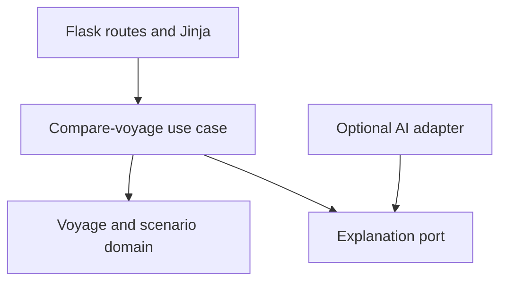
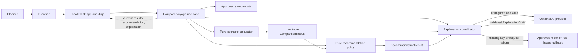

# Architecture Spine — VoyageAI V1

## Design Paradigm

Use a ports-and-adapters modular monolith with a small layered core. Flask and Jinja form the web adapter; an application use case coordinates each comparison; pure domain modules own voyage calculations and recommendation policy; an optional outbound adapter produces live AI explanations.

## Invariants & Rules

### AD-1 — One deployable modular monolith

- **Binds:** All V1 capabilities
- **Prevents:** Unneeded network, deployment, and integration boundaries between UI, calculations, recommendations, and explanations
- **Rule:** Ship one Python web application. Keep module boundaries in-process; do not introduce a separately deployed frontend, API service, worker, database, or message queue for V1.

### AD-2 — Inward dependency direction

- **Binds:** FR-1 through FR-8
- **Prevents:** Web, AI-provider, or rendering concerns changing deterministic domain behavior or creating competing implementations
- **Rule:** Presentation may depend on application; application may depend on domain and its own explanation port; domain must not depend on presentation, application, network, or provider code. The AI adapter implements the explanation port. The domain package is the sole owner of the approved immutable voyage fixture; application selects and passes it but does not duplicate or redefine it.



### AD-3 — Recompute from the approved source voyage

- **Binds:** FR-1, FR-2, FR-3, FR-4, SM-1, SM-2
- **Prevents:** Cumulative delay shifts, stale comparison results, and accidental user or operational state
- **Rule:** For each valid submitted integer delay from 0 through 720 minutes inclusive, calculate all scenarios from the original schedule plus that delay. Reject empty, non-numeric, non-finite, fractional, negative, or over-limit input without clamping, silently adjusting, or presenting results as current. Persist no voyage, delay, or planner decision state.

### AD-4 — Deterministic calculations with one precision boundary

- **Binds:** FR-2, FR-3, FR-4, FR-5, SM-1, SM-2
- **Prevents:** Scenario figures varying with request history, display rounding, or AI availability
- **Rule:** Pure domain functions implement the approved model in the cost-model specification: the fixed A–B speeds are 10, 12.5, and exactly 100/11 knots; B–C stays at 10 knots; fuel follows the specified cubic speed rule, 24-hour day, partial-day proration, 1-tonne/day berth wait, and USD 600/tonne price. The inclusive 8–13-knot limit applies per leg; an out-of-range target is infeasible, never clamped or reported as meeting a window. An early arrival waits for opening; arrival at opening or during a window starts the 12-hour stay; arrival at or after closing waits for the next listed window, and the stay may finish after closing. Use the specified exclusions, timezone-naive clock, and exact 100/11 input. Preserve exact rational quantities with `fractions.Fraction` through eligibility, comparison, and recommendation; apply PRD half-up rounding only at presentation (ETA to minute, fuel to 3 decimals, cost to cents).

### AD-5 — Recommendation is a pure domain policy

- **Binds:** FR-6, FR-7, SM-1, SM-3
- **Prevents:** A live model, provider outage, or rounded display value changing which scenario is recommended
- **Rule:** Use the current Keep 10 knots ETA at C as the reference; include scenarios whose unrounded ETA at C is no later; select the eligible scenario with the lowest unrounded simulated fuel cost; break equal-cost ties by earliest unrounded ETA at C. Return a typed `RecommendationResult` containing the selected scenario ID. The same policy result is used for live and fallback paths; render the selected scenario from this result, never by parsing provider prose.

### AD-6 — AI explains; it does not calculate or decide

- **Binds:** FR-6, FR-7, FR-8, SM-1, SM-3
- **Prevents:** Invented numbers, AI-dependent scenario results, or a recommendation that overrides the approved policy or planner
- **Rule:** The optional provider receives the current `ComparisonResult` and deterministic recommendation, and may return only an `ExplanationDraft` with qualitative `time_tradeoff` and `cost_tradeoff` text fields. It cannot calculate or mutate results, return a selected scenario, name another scenario as recommended, or author numeric claims; the application renders the recommendation and all numeric facts from domain results. Reject missing, malformed, contradictory, or numeric provider text and use the same fallback as for provider failure. Give each request finite connect/read deadlines and no automatic retries in V1. For a missing key or unsuccessful, nonconforming, or timed-out request, use the exact canonical mock iff the current valid delay is 720 minutes; use the rule-based fallback for every other valid delay from 0 through 719. Render the exact PRD labels, retain the current scenario comparison, and never reuse explanation text from an earlier delay. Both explanation modes cover time and cost trade-offs and disclose simulated/model limits; contractual, emissions, and operational factors are checks only, not assessed risks. The planner makes the final decision.

### AD-7 — Share one immutable scenario-result contract

- **Binds:** FR-3, FR-4, FR-5, FR-6, FR-7
- **Prevents:** Calculation, policy, explanation, and presentation modules interpreting scenario fields or precision differently
- **Rule:** Domain owns immutable `ComparisonResult` and `ScenarioResult` types. `ComparisonResult` binds the validated `delay_minutes` to exactly three scenario results in PRD order: Keep 10 knots, Increase to 12.5 knots, Reduce to 100/11 knots on A–B. Each `ScenarioResult` contains stable scenario ID and exact display label; A–B and B–C speed in knots as `Fraction`; arrival ETAs at B and C as timezone-naive `datetime`; berth wait in integer minutes; sailing, waiting, and total modelled fuel in tonnes as `Fraction`; and simulated fuel cost in USD as `Fraction`. Preserve the exact values to the presentation boundary; do not pass rendered or rounded strings into policy or explanation code.

## Consistency Conventions

| Concern | Convention |
| --- | --- |
| Naming and modules | Python package `voyageai`; separate `presentation`, `application`, `domain`, and `adapters` modules; use Python `snake_case` and explicit types at module boundaries. |
| Input and time | Delay is an integer minute value in the inclusive 0–720 range. Use the approved timezone-naive simulated clock; windows are start-inclusive/end-exclusive and follow AD-4. Keep scenario speeds fixed to AD-4; do not derive new speeds. |
| State and data | Domain owns the immutable sample and typed comparison contract. A request carries the current delay; no Flask session, database, or browser storage is authoritative. V1 uses no session features and needs no Flask session signing key. |
| User-visible contract | Show text that values are simulated and not live operational data or whole commercial costs; disclose that user needs are unvalidated. Identify live AI, the exact “Predefined mock — not a live AI explanation” or “Rule-based fallback — not a live AI explanation” source, and planner decision authority in text, not color alone. State that fuel during departure delay and port stays, port fees, demurrage, and other commercial/contractual costs are excluded; treat charter-party, laytime, emissions, and other operational factors as checks only. |
| Errors and fallback | Invalid delay returns a validation message without comparison or explanation. Calculation defects remain distinct from provider failures. Fallback routing, labels, and current-result constraints follow AD-6; render the 720-minute mock verbatim from `../../prds/prd-VoyageAI-2026-11-18/mock-12-hour.md`. |
| Configuration and secrets | Live AI is optional. Read `VOYAGEAI_AI_API_KEY` from the process environment only; do not add dotenv loading. Never commit or expose credentials to templates. No credential is needed for calculations or fallback. |
| Verification | Unit-test calculations and recommendation without Flask/network. Assert PRD 0-, 6-, and 12-hour oracles; 5:59/6:00/6:01 window boundary; speed limits; and 720 → 360 → 0 → 720 repeated edits. Use Flask's test client and injected provider fake to cover success, missing key, failed/timed-out/nonconforming response at 720 and a non-baseline delay; verify selected scenario, visible labels/comparison, exact mock, trade-offs/limitations, current numeric facts, and no stale prior explanation. Reject provider output containing numeric claims or an alternative recommendation. |
| Dependency maintenance | Scaffold `pyproject.toml`, `.python-version`, and `uv.lock`; use `uv sync --locked` for reproducible setup. Refresh runtime/dependency pins for security fixes, then rerun domain and web checks. `uv.lock` pins resolved project packages, not the uv executable. |

## Stack

These are proposed V1 scaffold baselines verified on 2026-11-20, not dependencies already present in this repository. Support CPython 3.14.x initially, with 3.14.10 as the seed interpreter. Do not claim support for Python 3.15 or later until the project tests that minor and verifies dependency compatibility.

| Name | Version | Role |
| --- | --- | --- |
| Python | CPython 3.14.x (3.14.10 seed; project range `>=3.14,<3.15`) | Runtime |
| Flask | 3.1.3 | Runtime |
| uv | 0.13.9 recommended CLI; installed separately, not pinned by `uv.lock` | Project tooling |

## Structural Seed



```text
repo-root/
  pyproject.toml                 # Proposed Python project metadata and dependencies
  .python-version                # Proposed uv interpreter selection: 3.14.10
  uv.lock                        # Proposed resolved project dependency versions
  src/voyageai/
    __init__.py                  # Flask create_app factory
    presentation/                # Flask routes, input validation, Jinja templates, static assets
    application/                 # Comparison orchestration and explanation port/coordinator
    domain/                      # Sole owner of fixture, calculations, result types, recommendation policy
    adapters/                    # Optional live AI provider adapter
  tests/
    domain/                      # Calculation, time-window, and recommendation oracles
    web/                          # Flask request, validation, fallback, and rendering tests
```

The only V1 environment is local development and demonstration from the repository. After scaffolding, run `uv run --python 3.14 flask --app voyageai:create_app run --host 127.0.0.1 --port 5000`; Flask debug mode is off by default. This development server is not a production deployment target. The optional AI adapter makes bounded outbound requests only when configured. There is no database, account system, session state, persistent operational state, production hosting, telemetry service, or live voyage-data integration. The app owns presentation of simulated-data and model-limit labels; no user research or operational validation is implied.

## Capability → Architecture Map

| Capability / Area | Lives in | Governed by |
| --- | --- | --- |
| FR-1 approved sample voyage | `domain` sample data; `presentation` dashboard | AD-2, AD-3 |
| FR-2 delay entry and validation | `presentation`; `application` request orchestration | AD-2, AD-3 |
| FR-3 downstream impact | `domain` scenario calculator; `presentation` labels | AD-2, AD-3, AD-4, AD-7 |
| FR-4 three fixed responses | `domain` scenario calculator; `presentation` response labels | AD-2, AD-4, AD-7 |
| FR-5 simulated cost model | `domain` scenario calculator; `presentation` exclusions/precision disclosures | AD-4, AD-7 |
| FR-6 recommendation and live explanation | `domain` recommendation policy; `application` explanation coordinator; optional `adapters` provider; `presentation` recommendation and source label | AD-2, AD-5, AD-6, AD-7 |
| FR-7 mock and rule-based fallback | `application` explanation coordinator; canonical copy in project data; `presentation` fallback label | AD-5, AD-6, AD-7 |
| FR-8 planner retains control | `presentation`; no operational-action adapter | AD-1, AD-6 |

## Deferred

- AI provider, model, SDK, exact finite timeout values, and provider-specific response parsing; choose when implementing the optional adapter. V1 has no automatic retries.
- Hosting, production operations, database, authentication, and persistent storage; outside the approved V1 scope.
- User-created voyages, additional samples, broader delay ranges, extra disruption types, and optimization; possible future product scope only.
- Client-side JavaScript or a separate JSON API; reconsider only if a demonstrated interaction requirement cannot be met with server-rendered pages.
- General timezone conversion and behavior beyond the approved berth-window/input envelope; not required by the current PRD oracle.
- Reconcile the stale sentence in PRD section 0 that calls the otherwise approved PRD a draft; it does not change this spine's source authority. Also align FR-6 wording before implementation if it is intended to mean that AI, rather than the deterministic policy, selects the recommendation.
- Product process criterion SP-1 (document AI-assisted development) is a project-record responsibility, not an application capability.